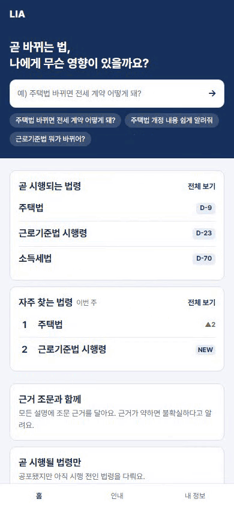
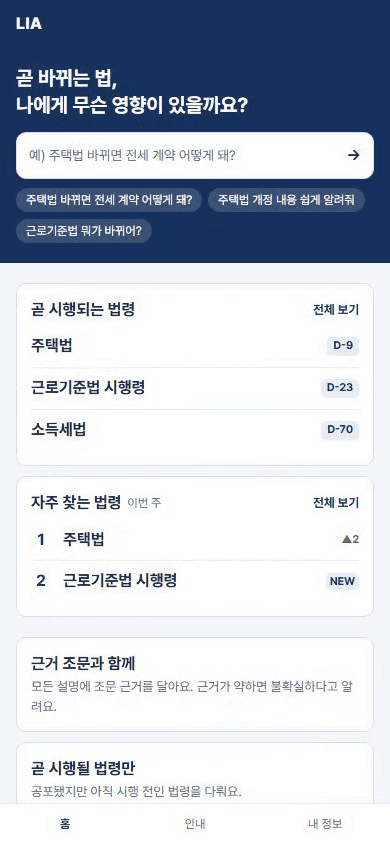
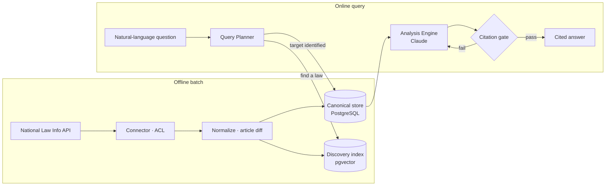

[한국어](README.md) · **English**

# LIA — Legislative Impact Analyzer

**A service that tells you what a soon-to-take-effect Korean law changes for you, backed by the actual statute text.**

[](https://github.com/HappyGogildong/Legal-data-impact-service/actions/workflows/ci-core.yml)
[](https://github.com/HappyGogildong/Legal-data-impact-service/actions/workflows/ci-web.yml)


<table>
  <tr>
    <td align="center"></td>
    <td align="center"></td>
  </tr>
  <tr>
    <td align="center"><b>Question → cited answer</b><br/>Summary, changed articles (current ↔ amended), enforcement rule.<br/>Every sentence cites a statute; uncertain parts are flagged</td>
    <td align="center"><b>Your situation → action plan</b><br/>Answer a follow-up question and the impact<br/>and to-dos are recomputed for your case</td>
  </tr>
</table>

<sub>The UI is in Korean.</sub>

---

## The problem

Korean laws are promulgated **before** they take effect. In between, it is hard for ordinary people to know what a change means for them — and asking a general-purpose LLM fails in three ways:

- **It doesn't know** — a specific amendment about to take effect is outside its training data.
- **It makes things up** — it confidently invents plausible article numbers.
- **It can't be verified** — there is no way to trace an answer back to the source text.

LIA does not compete with the LLM's reasoning. It feeds the model only articles confirmed from the trusted source (Korea's National Law Information Center), and **the code rejects any claim that doesn't cite one of them.** The scope is laws **already promulgated and waiting to take effect**, not bills whose passage is uncertain — only with a fixed effective date can "do this by then" be stated with confidence ([D42](docs/adr/decision-log.md)).

## Architecture



- **Ingestion and querying are separate.** Fetching, normalizing, and diffing laws is done once a day in a batch; the query path only does exact lookups of stored canonical versions.
- **Vector search is used only to find which law the user means.** Once the target is identified, the full canonical text is fetched by `(lawId, effective date)` and placed into the context as-is. Evidence is never selected by similarity search.

## Key engineering challenges

### 1. Blocking hallucinations in code — the citation gate
**Problem** Asking an LLM "don't make things up" in a prompt is not a guarantee.
**Decision** Every article placed in the context gets a `source_id`, and every claim in the response must **cite only injected `source_id`s**. On failure the answer is regenerated; if it keeps failing, no answer is returned (fail-closed).
→ [`AnalysisEngine`](core/src/main/java/com/lia/core/pipeline/analyze/AnalysisEngine.java) · [`FaithfulnessGate`](core/src/main/java/com/lia/core/eval/FaithfulnessGate.java) · [D08](docs/adr/decision-log.md)

### 2. LLM cost — call the model only when needed
**Problem** Putting the full statute into the model for every question is slow and expensive.
**Decision** Natural-language questions are translated into typed queries and routed. Facts, summaries, and article comparisons (Layer A) don't depend on the user, so they are precomputed and cached; only personalized impact and actions (Layer B) call the model. The source's per-article "changed" flag narrows the work to the articles this amendment touches — **137 → 6 articles** (measured on the Housing Act).
→ [`QueryPlanner`](core/src/main/java/com/lia/core/pipeline/plan/QueryPlanner.java) · [D07](docs/adr/decision-log.md)

### 3. An unreliable external API — contain its quirks in one layer
**Problem** The National Law Information API returns HTTP 200 even on authentication failure, returns an object instead of an array when there is exactly one result, and nests article text as `paragraph → item → sub-item`. It breaks by **silently returning zero results**, not by throwing.
**Decision** All such format issues are absorbed in an Anti-Corruption Layer, so only a normalized `Law` flows into the domain. Each pitfall confirmed in the field has its own unit test.
→ [`LawEnvelope`](core/src/main/java/com/lia/core/pipeline/connector/LawEnvelope.java) · troubleshooting [001](docs/troubleshooting/001-lawapi-display1-single-object.md) · [004](docs/troubleshooting/004-jejeong-law-no-baseline-english-envelope.md)

### 4. Batch reliability — overlapping runs, partial failures, reruns
**Problem** The external API can go down mid-run, a manual run can overlap the scheduled one, or only some laws can fail.
**Decision** Work is split into a DB task queue that workers claim with `FOR UPDATE SKIP LOCKED`, and an advisory lock ensures only one run at a time. Only changed items are processed, keyed by the law-version id (MST) and a content hash (revision), so **running twice in a row produces the same result.** Repeatedly failing tasks are quarantined so they don't block the next run.
→ [`TaskQueue`](core/src/main/java/com/lia/core/pipeline/batch/TaskQueue.java) · [`JobLock`](core/src/main/java/com/lia/core/pipeline/batch/JobLock.java) · [design doc](docs/components/batch/IngestJob.md) · [D62](docs/adr/decision-log.md)

## How quality is maintained

- **About 590 tests** — a thick layer of pure unit tests; real DB constraints and concurrency verified with Testcontainers (real Postgres); HTTP contracts, auth, and CSRF verified in a web slice running the actual `SecurityConfig`. Smoke tests against paid external APIs run only when keys are present.
- **Spec-first** — every class with behavior gets a [component spec](docs/components/) before code, and that contract drives the implementation.
- **Decision records** — [72 design decisions](docs/adr/decision-log.md) recorded with rationale and alternatives.
- **No unmeasured numbers** — performance optimizations are applied only after metrics confirm the bottleneck ([D48](docs/adr/decision-log.md)). The figure above (137 → 6) is measured.

## Tech stack

| Area | Used |
|---|---|
| Backend | Java 21 · Spring Boot 4.0 · Spring AI 2.0 · Spring Security (OAuth2: Google · Kakao · Naver) |
| Data | PostgreSQL + pgvector · Flyway |
| Models | Claude (reasoning) · OpenAI embeddings |
| Frontend | Next.js · Vitest · Playwright |
| Observability | Micrometer · Prometheus · Grafana · Tempo · Loki · k6 |

## Running locally

```bash
docker compose up -d db          # PostgreSQL + pgvector
cd core && ./gradlew test        # backend tests (external API smoke tests are skipped without keys)
cd web && npm install && npm run dev
```

All secrets live in a single `.env` at the repo root (see [`.env.example`](.env.example)).

## Further reading

The design documents are written in Korean.

| Document | Contents |
|---|---|
| [Feature spec](docs/product/feature-spec.md) | Features and screens from the user's perspective |
| [Architecture](docs/ARCHITECTURE.md) | Design snapshots and change history |
| [Decision log](docs/adr/decision-log.md) | Design decisions D01–D72 with rationale |
| [Troubleshooting](docs/troubleshooting/README.md) | Root-cause investigations of real problems |
| [Status](docs/status.md) | Implementation status and tech spec |
| [Onboarding](docs/onboarding.md) | Where to start reading the code |

---

This is an informational service, not legal advice. Every answer traces back to the statute, its addenda, and the amendment text, and no answer is produced when the evidence is insufficient.
