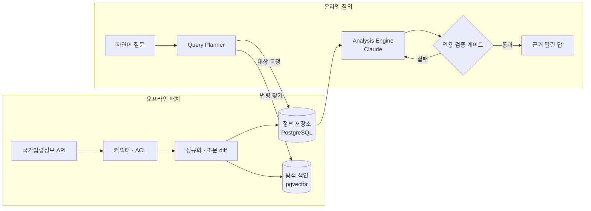

**한국어** · [English](README.en.md)

# LIA — 입법 영향 분석기

**곧 시행될 법령이 나에게 무엇을 바꾸는지, 조문 근거와 함께 답하는 서비스.**

[](https://github.com/HappyGogildong/Legal-data-impact-service/actions/workflows/ci-core.yml)
[](https://github.com/HappyGogildong/Legal-data-impact-service/actions/workflows/ci-web.yml)


<!-- TODO: 질문 → 근거 달린 답 흐름 GIF 1장 (web S02·S05 화면) -->

> **Q.** 2026년 8월 4일 시행되는 주택법 개정, 전세 세입자한테 뭐가 바뀌어?
>
> **A.** 사용검사 전 **현장점검을 요청할 권리**가 새로 생깁니다. 시행 이후 사용검사 신청 건부터 적용됩니다.
> — *근거: 주택법 제49조 · 부칙 제3조*

---

## 문제

법령은 시행 **전에** 공포된다. 그 사이 "이 법이 나에게 뭘 바꾸나"를 일반인이 알기는 어렵고, 범용 LLM에 물으면 세 가지가 문제다.

- **모른다** — 곧 시행될 특정 개정은 학습 범위 밖이다.
- **지어낸다** — 그럴듯한 조문 번호를 자신 있게 만들어 낸다.
- **검증할 수 없다** — 답의 근거를 원문까지 따라갈 수 없다.

LIA는 LLM의 추론력과 경쟁하지 않는다. 신뢰 출처(국가법령정보)에서 확인한 조문만 모델에 주고, **인용하지 않은 주장은 코드가 거부한다.** 분석 대상은 통과가 불확실한 발의 법안이 아니라 **공포 후 시행만 기다리는 법령**이다 — 시행일이 확정돼 있어야 "언제까지 무엇을 하라"가 성립한다([D42](docs/adr/decision-log.md)).

## 아키텍처



- **수집·적재와 질의를 분리**했다. 법령 수집·정규화·diff는 하루 한 번 배치로 미리 끝내고, 질의 경로는 저장된 정본을 정확 조회만 한다.
- **벡터 검색은 "어떤 법인지 찾기"에만** 쓴다. 분석할 법령이 정해지면 정본 전체를 `(lawId, 시행일)`로 조회해 그대로 컨텍스트에 넣는다. 유사도 검색으로 근거를 고르지 않는다.

## 핵심 기술 과제

### 1. 환각을 코드로 차단 — 인용 검증 게이트
**문제** LLM에게 "지어내지 마라"고 프롬프트로 부탁하는 것은 보증이 아니다.
**결정** 컨텍스트에 넣은 조문마다 `source_id`를 붙이고, 응답의 모든 주장이 **주입한 `source_id`만 인용**했는지 검사한다. 실패하면 재생성하고, 끝까지 실패하면 답을 내지 않는다(fail-closed).
→ [`AnalysisEngine`](core/src/main/java/com/lia/core/pipeline/analyze/AnalysisEngine.java) · [`FaithfulnessGate`](core/src/main/java/com/lia/core/eval/FaithfulnessGate.java) · [D08](docs/adr/decision-log.md)

### 2. LLM 비용 — 필요한 만큼만 부른다
**문제** 질문마다 법령 전문을 모델에 넣으면 비싸고 느리다.
**결정** 자연어 질문을 타입 있는 질의로 번역해 분기한다. 법령 사실·요약·조문 비교(Layer A)는 사용자와 무관하므로 미리 계산해 캐시하고, 개인화된 영향·대응(Layer B)만 모델을 부른다. 출처의 `조문변경여부`로 이번 개정에서 바뀐 조문만 추려 **137 → 6조문**(주택법 실측)으로 줄인다.
→ [`QueryPlanner`](core/src/main/java/com/lia/core/pipeline/plan/QueryPlanner.java) · [D07](docs/adr/decision-log.md)

### 3. 믿을 수 없는 외부 API — 기벽을 한 층에 가둔다
**문제** 국가법령정보 API는 인증 실패도 HTTP 200으로 주고, 결과가 1건이면 배열 대신 객체를 주며, 조문 본문이 `항 → 호 → 목`으로 중첩된다. 예외 없이 **조용히 0건**이 되는 식으로 깨진다.
**결정** 이런 형식 문제를 Anti-Corruption Layer에서 전부 흡수하고, 도메인 아래로는 정규화된 `Law`만 흐르게 했다. 실측으로 확인한 함정마다 단위 테스트를 둔다.
→ [`LawEnvelope`](core/src/main/java/com/lia/core/pipeline/connector/LawEnvelope.java) · 트러블슈팅 [001](docs/troubleshooting/001-lawapi-display1-single-object.md) · [004](docs/troubleshooting/004-jejeong-law-no-baseline-english-envelope.md)

### 4. 배치 신뢰성 — 중복 실행·부분 실패·재실행
**문제** 수집 도중 외부 API가 죽거나, 수동 실행과 정기 실행이 겹치거나, 일부 법령만 실패할 수 있다.
**결정** 작업을 DB 큐로 나눠 워커가 `FOR UPDATE SKIP LOCKED`로 가져가고, 실행 전체는 advisory lock으로 하나만 돌게 한다. 법령 버전 키(MST)와 본문 해시(revision)로 바뀐 것만 처리해 **두 번 연속 실행해도 결과가 같다.** 반복 실패하는 작업은 격리해 다음 실행을 막지 않는다.
→ [`TaskQueue`](core/src/main/java/com/lia/core/pipeline/batch/TaskQueue.java) · [`JobLock`](core/src/main/java/com/lia/core/pipeline/batch/JobLock.java) · [설계 문서](docs/components/batch/IngestJob.md) · [D62](docs/adr/decision-log.md)

## 품질을 지키는 방법

- **테스트 약 590개** — 순수 단위 테스트를 두껍게, 실제 DB 제약·동시성은 Testcontainers(실 Postgres), HTTP 계약·인증·CSRF는 실제 `SecurityConfig`를 띄운 웹 슬라이스로 검증한다. 유료 외부 API 스모크는 키가 있을 때만 돈다.
- **spec-first** — 행위가 있는 클래스는 코드보다 [컴포넌트 문서](docs/components/)를 먼저 쓰고, 그 계약이 구현을 이끈다.
- **결정 기록** — 설계 판단 [72건](docs/adr/decision-log.md)을 근거·대안과 함께 남겼다.
- **측정하지 않은 수치는 쓰지 않는다** — 성능 최적화는 지표로 병목을 확인한 뒤에만 적용한다([D48](docs/adr/decision-log.md)). 위의 수치(137 → 6)는 모두 실측이다.

## 기술 스택

| 영역 | 사용 |
|---|---|
| 백엔드 | Java 21 · Spring Boot 4.0 · Spring AI 2.0 · Spring Security(OAuth2: Google·Kakao·Naver) |
| 데이터 | PostgreSQL + pgvector · Flyway |
| 모델 | Claude(추론) · OpenAI 임베딩 |
| 프론트엔드 | Next.js · Vitest · Playwright |
| 관측 | Micrometer · Prometheus · Grafana · Tempo · Loki · k6 |

## 실행

```bash
docker compose up -d db          # PostgreSQL + pgvector
cd core && ./gradlew test        # 백엔드 테스트 (외부 API 스모크는 키가 없으면 건너뜀)
cd web && npm install && npm run dev
```

비밀값은 레포 루트 `.env` 하나로 관리한다([`.env.example`](.env.example) 참고).

## 더 읽기

| 문서 | 내용 |
|---|---|
| [기능 명세](docs/product/feature-spec.md) | 사용자 관점 기능 · 화면 |
| [아키텍처](docs/ARCHITECTURE.md) | 설계 스냅샷과 변경 이력 |
| [결정 로그](docs/adr/decision-log.md) | D01~D72 설계 결정과 근거 |
| [트러블슈팅](docs/troubleshooting/README.md) | 실제로 부딪힌 문제의 원인 추적과 해결 |
| [현황](docs/status.md) | 구현 상태 · 기술 스펙 |
| [온보딩](docs/onboarding.md) | 처음 코드를 읽는 순서 |

---

법률 자문이 아닌 참고용 정보 서비스다. 모든 답은 법령 조문·부칙·개정문으로 역추적할 수 있고, 근거가 부족하면 답하지 않는다.
