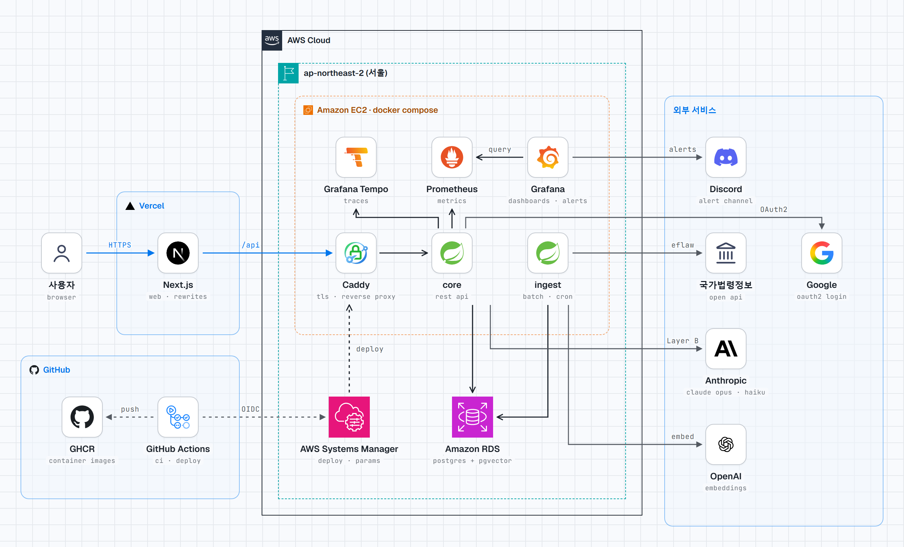
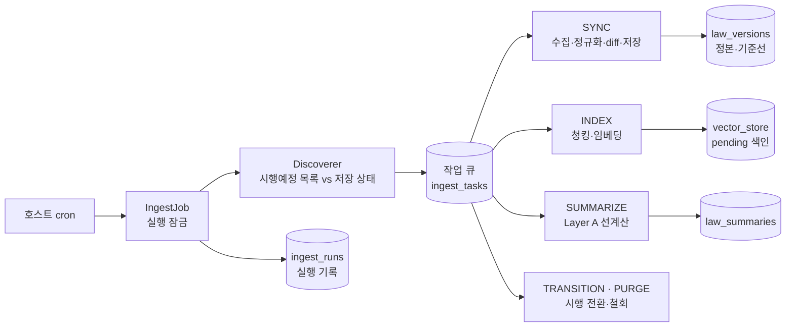
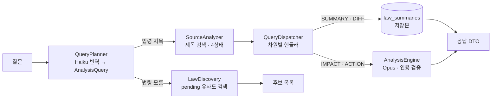
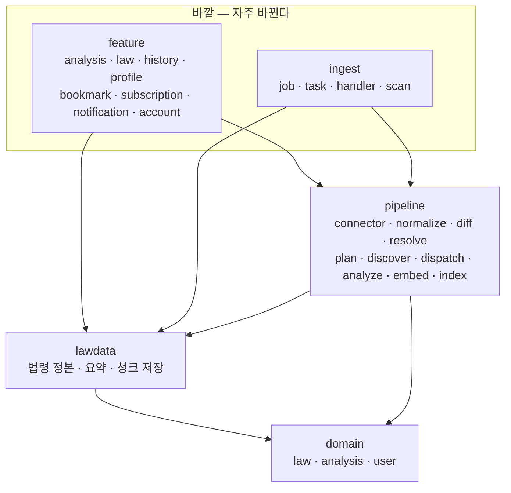

# 입법 영향 분석기 (LIA · Legislative Impact Analyzer) — 아키텍처 설계

> 곧 시행될 법령이 **나에게 어떤 변화를 주는지, 무엇을 해야 하는지**를
> 조문 근거와 함께 일반 시민의 언어로 알려주는 **웹앱** 서비스.

문서 버전 1.0 · 2026-11-25 · 상태: **현행(latest)**

> 변경 이력과 버전별 설계 이유는 [`../ARCHITECTURE.md`](../ARCHITECTURE.md) 색인 참고.
> 이 파일은 v1.0 시점의 **동결 스냅샷**이다. 수정하지 말 것 — 새 버전은 새 파일로.
> 컴포넌트 상세는 [`../components/component-specs.md`](../components/component-specs.md)와 `../components/`, 결정 이력은 [`../adr/decision-log.md`](../adr/decision-log.md)(D01~D90), 구현 현황은 [`../status.md`](../status.md).

---

## 1. 한 줄 정의와 설계 원칙

**공포됐지만 아직 시행되지 않은 법령**(국가법령정보 `eflaw`)을 대상으로(D42), 자연어 질문에 요약·바뀐 조문·내 영향·대응 방안을 조문 근거와 함께 답한다. v0.9 의 설계가 **운영 중인 서비스**가 된 시점의 스냅샷이다.

1. **그라운딩** — 모든 주장은 주입한 조문의 `source_id` 만 인용한다. 인용 검증에 실패하면 재생성하고, 끝까지 실패하면 답하지 않는다(D08).
2. **fail-closed** — 대상 법령을 확정하지 못하면 분석하지 않는다. 해소 4상태 RESOLVED · AMBIGUOUS · NOT_FOUND_YET · UNVERIFIED(D23).
3. **오프라인 먼저** — 사용자와 무관한 일(수집·정규화·diff·색인·요약·변경점)은 배치가 미리 끝낸다. 온라인 Opus 호출은 개인화(Layer B)에만 남는다(D40·D80).
4. **LLM 은 번역기** — 자연어를 타입 DTO 로 바꾸는 데만 쓰고, 그 뒤 실행은 결정론이다(D46).
5. **측정 선행** — 수치는 실측만 쓰고, 최적화는 지표로 병목을 확인한 뒤에(D48). 유료 호출은 1회 = 1행으로 남긴다(D83).

---

## 2. v1.0 핵심 — v0.9 이후 실체가 된 것

v0.9 는 질의 경로를 *설계*했다. v1.0 은 그 설계가 **배치·사용자 기능·운영·평가**를 갖춘 서비스로 돌아가는 상태다.

| 영역 | v1.0 의 모습 | 결정 |
|---|---|---|
| 적재 | 1회성 배치 잡 + **DB 작업 큐**(`SKIP LOCKED`·실행 잠금·격리), 내용 해시로 바뀐 것만 처리 | D62·D85 |
| Layer A | 요약·변경점을 **배치가 선계산해 저장**, 온라인은 저장본만 읽는다(Opus 0) | D67·D80·D82 |
| Layer B | 프로필 기반 내 영향·대응 방안, 상황 질문으로 대응 방안 재생성, 사용자별 하루 한도 | D69·D71·D79 |
| 발견 | 법령 이름 없는 질문 → `pending` 색인 유사도 검색 → 법령 단위 후보 | D70 |
| 사용자 기능 | 소셜 로그인·동의·프로필, 북마크·이력·구독·알림함, 법령 목록·상세·자주 찾는 법령 | D60·D61·D65·D66·D72~D74 |
| 운영 | AWS 단일 EC2(compose) + RDS, 웹은 Vercel, **main 머지 = 배포** | D59·D63·D64·D78·D86 |
| 품질 | RAG 오프라인 평가·회귀 게이트·운영 보고서, LLM 호출·질의 이벤트 기록 | D83·D84 |
| 해소 | 이름 해소는 적재분 제목 검색, 정확한 제목 우선, 번역기가 정식 명칭으로 | D87~D89 |
| 코드 | 패키지 두 축(단계별·기능별) + ArchUnit 의존 규칙 | D90 |

---

## 3. 시스템 구성

> 다크 테마: [`v1.0-system-dark.png`](../assets/architecture/v1.0-system-dark.png) · 원본(단독 HTML): [`v1.0-system.html`](../assets/architecture/v1.0-system.html). 근거는 `ops/deploy/docker-compose.prod.yml`.

| 구성 요소 | 위치 | 역할 |
|---|---|---|
| Next.js 웹 | Vercel | 화면 S01~S16. `/api` 는 rewrites 로 core 에 프록시 — 브라우저 입장에선 같은 출처(D64) |
| Caddy | EC2 compose | TLS 종료·리버스 프록시 |
| core | EC2 compose | Spring Boot 4.0 + Spring AI 2.0. REST API·질의 경로·사용자 기능 |
| ingest | EC2 compose(`batch` 프로필) | core 와 **같은 이미지**의 1회성 배치. 호스트 cron 이 매일 04:00, 일요일 05:00 `--full` 로 띄운다 |
| Prometheus · Tempo · Grafana | EC2 compose | 지표·트레이스·대시보드. 배치 대시보드와 경보 3개는 Grafana 가 DB 를 직접 읽어 Discord 로(D63). Grafana 는 공개하지 않고 SSM 포트 포워딩으로만 |
| Amazon RDS | 같은 리전 | PostgreSQL 16 + pgvector(HNSW). 정본·색인·사용자 데이터·실행 기록을 한 DB 에(ADR-001) |
| AWS Systems Manager | AWS | 접속(SSH 포트 없음)·배포 문서 `LIA-Deploy`·Parameter Store(비밀값을 실행할 때만 환경변수로) |
| GitHub Actions · GHCR | GitHub | 테스트 → arm64·amd64 이미지 → OIDC 로 배포 역할을 받아 SSM 문서 실행(D86) |
| 외부 API | — | 국가법령정보(수집), Anthropic(Opus 5.5 추론·Haiku 4.5 번역), OpenAI(`text-embedding-3-small`), Google OAuth, Discord(경보) |

---

## 4. 실행 모드

같은 애플리케이션, 두 가지 실행. **온라인에 새 작업을 넣기 전에 "오프라인으로 미리 할 수 없나"를 먼저 묻는다.**

### 4.1 오프라인 — 배치 적재 (D62)

| 작업 | 하는 일 | 성질 |
|---|---|---|
| `SYNC` | 국가법령정보 본문·기준선 수집 → 정규화(같은 날 공포본 병합, D85) → 조문 diff → 정본 저장. 저장과 `INDEX` 등록은 한 트랜잭션 | revision(내용 해시)이 같으면 건너뛴다 |
| `INDEX` | 변경 조문 + 개정 이유를 청킹해 `pending` 색인 교체(한 트랜잭션) | 임베딩 유료 — 바뀐 버전만 |
| `SUMMARIZE` | 같은 분석 엔진으로 요약·변경점을 만들고 인용 검증을 통과한 것만 저장 | Opus 유료 — 운영 일괄 생성은 승인 전까지 꺼 둠 |
| `TRANSITION` · `PURGE` | 시행일이 지난 버전을 시행중으로, 목록에서 다른 날 두 번 사라진 버전을 철회로. 색인에서 뺀다 | 행은 지우지 않는다 — 과거 답의 인용을 되짚을 수 있게 |

재실행 안전: 워커는 `FOR UPDATE SKIP LOCKED`, 실행 전체는 advisory lock 으로 하나만, 실행 토큰 소유권으로 늦은 완료가 결과를 덮지 못한다. 실행당 1회 + 3회 실패면 격리(DEAD)하고 경보. 목록이 비정상적으로 비면 사라짐 판정을 하지 않는다(D77).

### 4.2 온라인 — 자연어 질의 (D46)

| 질의 타입 | 계층 | 답의 출처 | 온라인 비용 |
|---|---|---|---|
| `LOOKUP` | 발견 | `pending` 색인 유사도 검색 → 법령 단위 후보 | 임베딩 1회 |
| `SUMMARY` | A | 배치 저장본. 없으면 `NOT_PRECOMPUTED` | 0 |
| `DIFF` | A | 배치 저장본. 특정 조문을 물으면 그 조문으로 좁힌다(D82) | 0 |
| `IMPACT` · `ACTION` | B | 정본 + 프로필로 Opus 1회, 근거 부족이면 재생성 ≤2 | Opus — 사용자별 하루 20회 |

- 번역(Haiku)은 요청마다 1회. 익명 분석은 서비스 전체 하루 상한(D81).
- **분석 경로에는 벡터 검색이 없다.** 대상이 정해지면 정본과 기준선을 `(법령ID, 시행일)` 로 정확 조회해 통째로 넣는다(D55). 벡터 검색은 "어떤 법인지 찾기"에만.
- 대응 방안은 상황 질문(최대 3)에 답하면 그 답을 반영해 다시 만든다. 질문은 세션에만 둔다(D71).

---

## 5. 데이터

단일 PostgreSQL 16 + pgvector(ADR-001). 관계형 스키마는 Flyway(V1~V17), 벡터 테이블은 Spring AI `PgVectorStore` 가 소유한다.

| 묶음 | 테이블 | 쓰는 쪽 |
|---|---|---|
| 법령 데이터 | `law_versions`(정본·기준선, 상태 4종) · `vector_store`(`pending` 색인) · `law_summaries`(Layer A 저장본) | 배치가 쓰고 질의가 읽는다 |
| 사용자 | `accounts` · `user_profiles` · `law_bookmarks` · `analysis_history` · `law_subscriptions` · `notifications` | 사용자 기능 |
| 사용량 | `personalization_usage_daily` · `anonymous_analysis_usage_daily` · `law_views_daily` | 한도·상한·자주 찾는 법령 |
| 실행·관측 | `ingest_runs` · `ingest_tasks` · `ingest_task_attempts` · `llm_calls` · `query_events` | 배치·대시보드·비용 |

비용은 저장하지 않고 조회할 때 `llm_calls` × 시점별 단가(`llm_prices`)로 계산한다(D83).

---

## 6. 코드 구조 (D90)

- **두 축.** 데이터가 단계를 차례로 지나는 코드(`pipeline`·`ingest`)는 단계별, 화면에서 DB 까지 한 줄로 이어지는 사용자 기능은 기능별(`feature/*` — 컨트롤러·유스케이스·DTO·저장소를 한 폴더에).
- **의존은 안쪽으로만.** `domain` 은 아무것도 모르고, `lawdata` 는 `domain` 만, `pipeline` 은 기능·배치를 모른다. 기능끼리는 history → analysis → {law, profile}, profile → account 만.
- **테스트가 강제한다.** `ArchitectureTest`(ArchUnit)가 의존 방향·순환 금지·관례(유스케이스에 Spring 스테레오타입 금지 등)를 검사한다. 남은 예외 3건은 클래스 단위로 명시.
- 포트는 교체가 실제로 예정된 것만(D87 `LawLookup`), Repository 추상화는 두지 않는다(Postgres 고정, D04).

---

## 7. 운영

- **배포(D86).** main 머지 → CI(테스트·이미지) → `deploy` 잡이 OIDC 로 역할을 받아 SSM 문서 `LIA-Deploy` 실행 → 서버가 배치 종료를 기다리고 잠금 뒤 `lia up`. 이미 배포된 것보다 옛 커밋이면 건너뛴다. 롤백은 Actions 수동 실행에 이전 SHA.
- **공격 표면.** SSH 포트를 열지 않는다(SSM). Grafana 는 공개하지 않는다. 공개 레포라 GitHub 역할은 "정해진 배포"만 할 수 있다.
- **관측.** 요청 경로는 Prometheus 지표·Tempo 트레이스, 배치는 `ingest_runs` 대시보드와 경보 3개(격리 발생·26시간 완료 실행 없음·목록 미완주 연속), 유료 호출과 질의 결과는 DB 기록(`LIA · Token & Cost`·`LIA · Requests`).
- **평가(D83).** 정답 세트 39문항을 서비스 경로(`QueryPlanner` → `LawDiscovery`)로 돌리는 `lia eval`, 기준선 대비 회귀 게이트, 보고서는 `docs/eval/reports/`(JSON·HTML, 문항별 결과).
- **비용 장치.** Layer A 선계산(온라인 Opus 0), 바뀐 조문만 모델에 넣기, Layer B 사용자별 하루 한도·익명 상한, 유료 배치·평가는 명시적으로 켤 때만. 정책은 [`../backend/cost-policy.md`](../backend/cost-policy.md) 한 곳에.

---

## 8. 다음 단계

- 개인정보처리방침 확정·게시(#35) — 평가 4·5단계(운영 표본 판정)의 전제.
- 알림 이메일 발송(⑦c, #32).
- 운영 Layer A 일괄 요약 생성 — 비용 승인 뒤.
- 보류: 프로필 관련 구독(⑦b, contextual retrieval 도입 때), 법령 이름 해소 재설계(#104).
- 부하 측정(ADR-001 Action Item, k6) — 지금 숫자가 없는 성능 슬롯을 실측으로 채운다.
